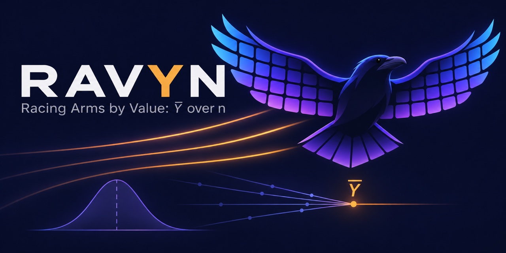

<p align="center">
  
</p>

# RAVYN

**Pronunciation:** *RAY-vən* (/ˈreɪvən/), like "raven".

**Racing Arms by Value: Ȳ over n**

A crossword-game analysis engine in Rust, built for Crossplay and also
playing standard Scrabble. RAVYN generates every legal play, values each by
score and leave, then races the candidates as bandit arms: each playout
samples an outcome *Y*, and arms are dropped once their mean Ȳₙ is clearly
behind the leader's.

## What it does

- **Move generation** over a flattened word graph, with anchor bounds that
  search the most promising squares first (identical plays and scores to
  a reference engine on 32 positions)
- **Simulation** of every candidate as a continuous parallel pipeline, with
  best-arm racing on spread and win rate
- **Rack inference**: what the opponent probably kept, given their play
- **Leave values trained by self-play** (`data/leaves.rlv`, all 921,298
  leaves), 16 points of spread a game stronger than the per-letter heuristic
- **Exact endgames**: Crossplay's equal-turn ending, and Scrabble's go-out
  ending by negamax
- **Exact pre-endgame** with one tile in the bag (Crossplay), the pass
  included, and with two (every play, within a time budget, saying
  whether the best is proven)
- **Rules as data**: `rules::CROSSPLAY` and `rules::SCRABBLE`
- **Game records (GCG)**: read, write and replay them, and review a game
  move by move against the engine's best

## Command line

```bash
cargo run --release --bin ravyn -- gen '15/15/15/15/15/15/15/15/15/15/15/15/15/15/15 AEINRST/ 0/0 0'
cargo run --release --bin ravyn -- --help
```

Commands: `fetch-data` (the data files), `gen`, `sim`, `endgame`, `preendgame`, `infer` (on CGP positions),
`gcg` (review a game record, or print one of its positions with `--at N`),
`train-leaves` and `match` (leave tables). `--rules scrabble` switches rules.

## Data

The data files live in their own repository, versioned and checksummed:

```bash
ravyn fetch-data        # into ~/.ravyn/data (or --data DIR)
```

It installs only files that match the published SHA-256 checksums. No
account or token is needed; for a private copy of the data repository,
`$RAVYN_DATA_TOKEN`, `$GITHUB_TOKEN` or a `gh auth login` supplies one. The CLI looks for `data/` in
`--data`, `$RAVYN_DATA`, the current directory, then `~/.ravyn`; tests and
benchmarks use `data/` beside the crate when present. The crate package
leaves out the word list; `data/leaves.rlv`, RAVYN's own trained leave
values, ships with it.

## Development

```bash
cargo fmt --all -- --check
cargo clippy --all-targets -- -D warnings
cargo test --release
cargo bench --bench engine
```

RAVYN is developed inside [RAVYL](https://github.com/OneTrueJASH/ravyl)
(`crates/ravyn`), its first user, and synced here. See
[CONTRIBUTING.md](CONTRIBUTING.md).

## License

[MIT](LICENSE)

RAVYN is an independent project, not affiliated with Crossplay or Scrabble.
